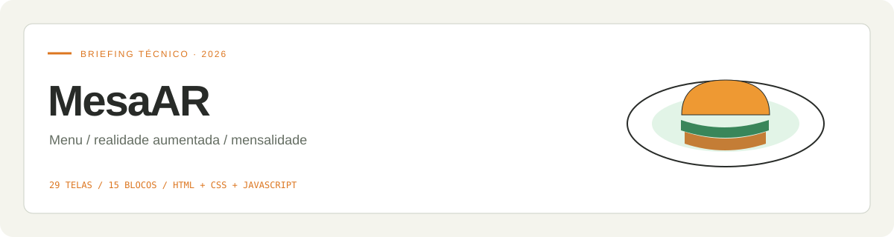

<div align="center">



# MesaAR · Cronograma 2027

**Agenda de entregas · Calendário · Estudos · Monografia e INIC**

Início em **1º de fevereiro de 2027** · Entrega principal em **30 de julho de 2027** · Reserva até **30 de setembro de 2027**

[Abrir cronograma ↗](https://perabru.github.io/mesaar-cardapio-ar/) · [Protótipo navegável](prototipo/) · [Briefing](briefing.html) · [Cronograma completo](docs/cronograma.md) · [Monografia e INIC](docs/monografia-inic.md)

</div>

## Protótipo navegável

[**Abrir protótipo ↗**](https://perabru.github.io/mesaar-cardapio-ar/prototipo/)

Percorra cardápio, prato, simulação de AR, sacola e confirmação; depois confira o pedido na cozinha. Telas clicáveis com dados demonstrativos e a identidade visual do projeto.

[Código do protótipo](prototipo/) · [Fluxos e manutenção](prototipo/README.md)

## Identidade visual 2027

**Veja à mesa. Escolha com clareza.**

A vista superior de um prato encontra os quatro cantos de enquadramento da realidade aumentada. Uma folha central adiciona um gesto humano e gastronômico à geometria da tecnologia.

**Personalidade:** Acolhedor · Apetitoso · Claro.

[**Explorar o manual visual ↗**](https://perabru.github.io/mesaar-cardapio-ar/identidade-visual/) · [**Baixar guia PDF**](identidade-visual/guia-identidade-visual.pdf) · [**Baixar kit da marca**](identidade-visual/kit-identidade-visual.zip)

O guia reúne conceito, assinaturas, construção, área de proteção, redução mínima, cores, tipografia, fundos, usos incorretos e aplicações. O kit inclui as marcas em SVG, os arquivos de fontes com suas licenças e os dados da identidade.

| Cor | HEX | Aplicação |
| --- | --- | --- |
| Terracota | `#AB432B` | Marca, chamadas e botões principais. |
| Creme à mesa | `#FFF6E8` | Fundo acolhedor e áreas de leitura. |
| Café | `#3D2A22` | Textos e marca monocromática. |
| Verde ervas | `#52683B` | Destaques secundários e detalhes gastronômicos. |
| Porcelana | `#FFFCF6` | Cartões, menus e espaços de respiro. |

**Tipografia:** Outfit nos títulos, Nunito Sans nos textos e JetBrains Mono nos dados técnicos.

Estrutura editorial inspirada no [Manual de Identidade Visual de São José dos Campos](https://www.sjc.sp.gov.br/media/aqpbdbrj/14448_e_s7_identidade-visual-psjc.pdf). As marcas e aplicações foram desenvolvidas para este projeto.

## Aprender para construir

[**Abrir trilha de estudos ↗**](https://perabru.github.io/mesaar-cardapio-ar/#study)

- 8 etapas entre fevereiro e julho, com prática, critérios e entregas relacionadas.
- 19 fontes de estudo e 11 arquivos autorais para download.
- Hardware, BOM, matriz de referências e protocolo de experimento.
- Progresso local com backup próprio, busca e impressão da trilha.

[Guia completo](docs/trilha-de-estudos.md) · [Baixar kit](materiais/kit-estudos-mesaar.zip) · [Revisão das datas](docs/revisao-fevereiro.md)

O Drive de Pobre foi solicitado e a tentativa de consulta ficou registrada: o catálogo exigiu verificação humana. Nenhum arquivo desse acervo foi validado ou redistribuído. A curadoria usa fontes primárias e exercícios próprios.

## Agenda 2027

A página inicial abre em **Entregas**: próxima data, seletor de mês e linhas com data, entrega, responsável e situação. Em **Calendário**, selecione um dia e abra a entrega para marcar o checklist; quadro completo, estudos, documentos e backups ficam em **Mais**.

| Frente | Entrega planejada |
| --- | --- |
| Produto / engenharia | Construção, integração, validação e versão final até julho |
| Monografia | Fundamentação, método, resultados, discussão, revisão e depósito |
| Artigo INIC | Escrita desde junho; texto integral em junho e pacote pronto em julho |
| Gestão | Recursos, responsáveis, revisões e apresentação |
| Reserva | Correções e adaptação em agosto e setembro |

As datas do INIC 2027 são **metas internas de prontidão**, sem inventar prazo oficial de submissão. Consultar a [página do evento](https://www.univap.br/inic/) e o [modelo vigente](https://www.univap.br/inic/submissao_trabalhos.php).

## Interações disponíveis

- 58 registros, sendo 2 históricos arquivados; 56 cartões ativos com responsável, início, prazo, prioridade, dependências e critérios de conclusão.
- Em **Mais → Quadro de tarefas**: colunas por frente ou estado, filtros completos e reordenação no computador.
- Checklist e edição de prazo e responsável no detalhe da entrega, também pelo celular.
- Em **Mais**: linha do tempo, estudos, monografia, artigo e responsáveis.
- Notas, evidências, arquivamento reversível e desfazer.
- Backup JSON, exportação CSV, calendário ICS e impressão completa.

## Abra e continue

Baixe o repositório e abra `index.html`. HTML, CSS, JavaScript, fontes e símbolo da marca estão incorporados. Nenhuma instalação é necessária para usar a agenda.

```bash
git clone https://github.com/perabru/mesaar-cardapio-ar.git
cd mesaar-cardapio-ar
```

> **Dados locais:** as alterações ficam neste navegador. Não há sincronização automática entre pessoas ou dispositivos. Exporte JSON e importe no mesmo projeto para compartilhar o andamento. Os dados do usuário não são enviados ao GitHub.

[Manual de uso e backup →](docs/uso-do-quadro.md)

## Monografia com revisão ABNT

A escrita acompanha a pesquisa. Os cartões cobrem estrutura, método, resultados, revisão e apresentação, com apoio nas NBR 14724:2024, 10520:2023, 6023:2025, 6028:2021, 6024:2012 e 6027:2012. O projeto de pesquisa também considera a NBR 15287:2025 quando aplicável.

O manual institucional e a orientação definem a aplicação final. Este quadro organiza a revisão; não emite certificação automática de conformidade.

[Etapas de escrita, normas e fontes →](docs/monografia-inic.md)

## Arquivos principais

| Arquivo | Função |
| --- | --- |
| [`index.html`](index.html) | Agenda de entregas e calendário |
| [`prototipo/index.html`](prototipo/index.html) | Protótipo navegável |
| [`briefing.html`](briefing.html) | Briefing técnico anterior |
| [`plano-inicial.json`](plano-inicial.json) | Cópia do planejamento original |
| [`docs/cronograma.md`](docs/cronograma.md) | Inventário das entregas |
| [`docs/monografia-inic.md`](docs/monografia-inic.md) | Escrita acadêmica e fontes |
| [`docs/uso-do-quadro.md`](docs/uso-do-quadro.md) | Manual e backup |
| [`README_BRIEFING.md`](README_BRIEFING.md) | Apresentação anterior do projeto |

Os demais documentos de arquitetura, telas e tecnologias permanecem em `docs/`.

## Verificação

```bash
node tests/cronograma.test.cjs
```

Os testes verificam datas, dependências, importação, conclusão, exportações e limites do plano.

---

Projeto de [Bruno Michel Pera](https://github.com/perabru) · [Créditos e licenças](THIRD_PARTY_NOTICES.md)

