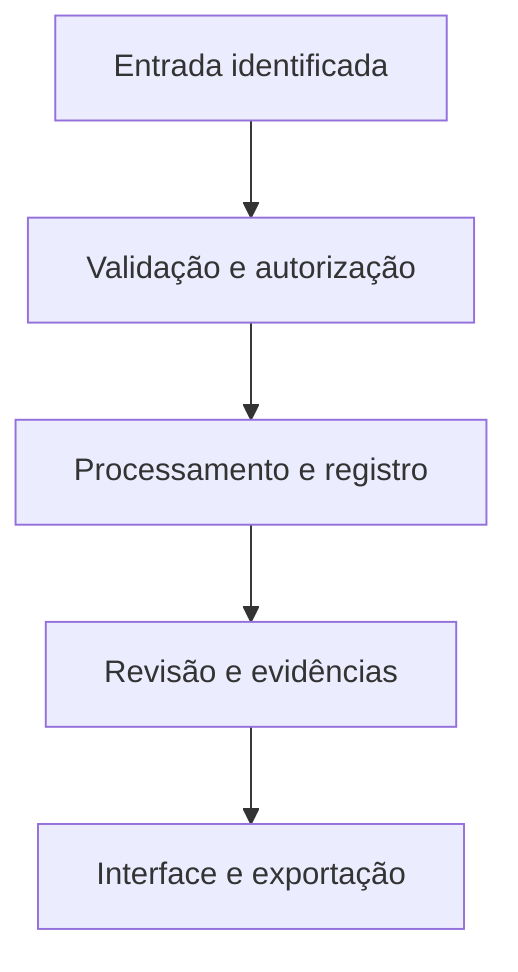

# Arquitetura proposta

## Descobrir

QR/link identifica unidade e mesa.

## Escolher

Preço, porção, ingredientes e alergênicos.

## Visualizar

3D, AR compatível e escala conferida.

## Pedir

Sacola, revisão e pagamento confirmado.

## Operar

Cozinha, cardápio, equipe e assinatura.

## Dados do domínio

- **Restaurant / Unit / Table** — Estabelecimento, unidade, mesa e permissões.
- **Dish / Ingredient / Allergen / Availability** — Ficha real do preparo, porção, preço em centavos e disponibilidade.
- **ModelAsset / ScaleReview** — GLB/USDZ, dimensões em metros, autoria e validação.
- **Cart / Order / OrderItem** — Sacola por unidade e snapshot de preço confirmado.
- **Payment / ProviderEvent** — Identificador externo, valor, estado e evento deduplicado.
- **Subscription / Plan / Invoice** — Mensalidade do software, ciclo, fatura e estado independentes do pedido.

## Contas e permissões

Sessão no servidor, autorização por papel e propriedade, arquivos privados por escopo e auditoria de mudanças. A interface nunca é a única barreira de acesso.
